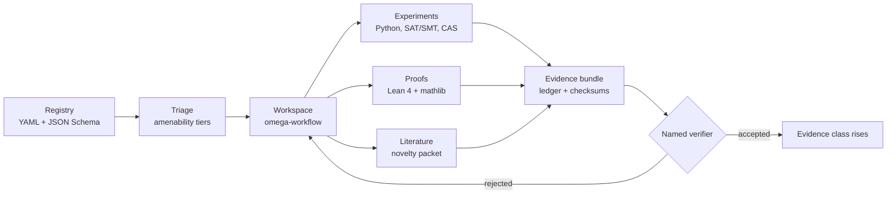

# OMEGA

**Open Mathematics Exploration by Generative Agents**: a research workbench for working on open mathematical problems with AI help, while keeping every claim traceable to evidence.

[](https://github.com/KonkovDV/OMEGA-MATH/actions/workflows/ci.yml)
[](https://github.com/KonkovDV/OMEGA-MATH/actions/workflows/validate.yml)
[](https://github.com/KonkovDV/OMEGA-MATH/actions/workflows/lean.yml)
[](https://github.com/KonkovDV/OMEGA-MATH/actions/workflows/codeql.yml)
[](https://scorecard.dev/viewer/?uri=github.com/KonkovDV/OMEGA-MATH)


[Русская версия ниже](#по-русски)

---

## What OMEGA is, and what it is not

OMEGA does not prove theorems on its own. It is the bookkeeping and plumbing around that work:

- a **registry** of open problems in YAML, checked against a JSON schema;
- a **triage** step that estimates how much a problem is likely to benefit from computation and AI;
- a **per-problem workflow** with explicit, restartable stages;
- **experiment ledgers and evidence bundles** with checksums, so a result can be traced back to the run that produced it;
- **adapters** for Lean 4, SAT/SMT solvers and computer algebra;
- a **novelty check** against the literature before anyone calls a result new.

What it does not claim, so you do not have to dig for it:

| OMEGA does **not** claim | Why it matters |
|---|---|
| Any new mathematical result | None exists in this repository. The flagship scripts reproduce known values. |
| Automatic correctness | A result counts only after a named human or formal verifier signs off. |
| Complete literature coverage | Since 2025 several "open" problems turned out to be solved already ([arXiv:2601.22401](https://arxiv.org/abs/2601.22401)). The novelty packet reduces this risk; it does not remove it. |
| A host-independent toolchain | Lean, z3 and SAT availability is probed per machine and reported as such. |

## Snapshot (13 October 2026)

Every number below was recomputed on that date; the method is in the [fact-check table](docs/AUDIT_2026-10.md#fact-check).

| Item | Value | How it was checked |
|---|---|---|
| Version | `0.6.0` | `pyproject.toml`, `omega-verify-version-sync` |
| Problems in the registry | 252 | count of entries in `registry/domains/*.yaml`, matches `registry/index.yaml` |
| Triaged problems | 73 of 252 (29%) | `registry/index.yaml` |
| Tiers | T1 28 · T2 22 · T3 10 · T4 5 · T5 8 · untriaged 179 | `registry/index.yaml` |
| Domain files | 14 active + 1 redirect | `registry/domains/` |
| Collections | 6 | `registry/collections/` |
| Tests | 273 passed, 8 skipped | `python -m pytest -q` on Windows 11, Python 3.12.10 |
| Lean | one checked statement (Erdős–Straus, n ≡ 3 mod 4) | `lean.yml` workflow, mathlib v4.29.0 |

## How it fits together



Model and prover backends are pluggable (`omega-model-router`, `omega-lean`, `omega-solve`, `omega-cas`), so a better model or prover can be swapped in without touching the registry or the evidence format.

## Flagship tracks

| Problem | What runs today | Independently checked |
|---|---|---|
| Erdős–Straus conjecture | covering analysis of the residues mod 840 left open by Mordell; bounded decomposition search; one Lean proof | Mordell's six residues `1, 121, 169, 289, 361, 529` recomputed; every n from 2 to 3000 has a decomposition |
| Kobon triangles | pseudoline arrangement search with simulated annealing | known optima for k ≤ 17 match [OEIS A006066](https://oeis.org/A006066) |
| Thomson problem | multistart, basin hopping, and a numerical certificate (tangent forces plus a full-precision Hessian) | energies for N = 2…12 recomputed by an independent optimizer; N = 10…100 match the [Cambridge Cluster Database](https://www-wales.ch.cam.ac.uk/~wales/CCD/Thomson/table.html) |

For scale: Erdős–Straus has been checked by others up to 10^17 ([Salez](https://arxiv.org/abs/1406.6307)) and 10^18 ([arXiv:2509.00128](https://arxiv.org/html/2509.00128)). OMEGA's scripts are a test bed for the workflow, not a competitor to those searches.

## Quick start

```bash
git clone https://github.com/KonkovDV/OMEGA-MATH.git
cd OMEGA-MATH
python -m pip install -e .[all]

omega-validate-registry
omega-verify-version-sync
python -m pytest -q
```

Then walk one problem through the workflow:

```bash
omega-scaffold-problem erdos-straus --title "Erdos-Straus Conjecture"
omega-workflow triage erdos-straus
omega-workflow status erdos-straus --format json
omega-literature novelty-packet "erdos-straus conjecture unit fractions" --problem-id erdos-straus --max-items 10
omega-orchestrate run erdos-straus --stage plan --dry-run
```

`omega-orchestrate` reads `agents/`, `registry/` and `research/` from the checkout, which is why the install is editable. Those folders are not part of the wheel.

### Lean

```bash
cd research/active/erdos-straus/proof/lean
lake exe cache get
lake build
```

You need [elan](https://github.com/leanprover/elan); the toolchain is pinned in `lean-toolchain`.

## Reproducibility

- Core dependencies are pinned (`PyYAML==6.0.3`, `jsonschema==4.26.0`); mathlib and its dependencies are pinned in `lake-manifest.json`.
- CI runs on Python 3.12 and 3.13. Every GitHub Action is pinned by commit hash.
- Experiment scripts take a `--seed` and write JSON artifacts; `omega-verify-evidence` checks bundle checksums.
- Windows works: scripts switch their output to UTF-8, so a Russian or other non-UTF-8 console no longer crashes them.
- Machine reports in [`reports/`](reports) state which tools were present on the machine that produced them.

## Documentation

Organised along the four kinds of documentation described by [Diátaxis](https://diataxis.fr/).

| Kind | Start here |
|---|---|
| Tutorial | this README, quick start above |
| How-to | [operator runbook](protocol/operator-runbook.md), [Lean bootstrap](protocol/lean-bootstrap.md), [publication workflow](protocol/publication-workflow.md) |
| Reference | [PROTOCOL.md](PROTOCOL.md), [orchestrator contract](protocol/orchestrator-contract.md), [prover result contract](protocol/prover-result-contract.md), [evidence governance](protocol/evidence-governance.md), [registry schemas](registry/schemas) |
| Explanation | [roadmap](docs/ROADMAP.md), [audit, October 2026](docs/AUDIT_2026-10.md), [triage calibration](docs/AMENABILITY_CALIBRATION.md), [SOTA landscape](research/OMEGA_SOTA_LANDSCAPE_UPDATE_2026_10_12.md) |

Older files in `docs/research/` (pitch decks, go-to-market notes, an upgrade prompt) are kept for history. They are not part of the technical documentation and are not maintained.

## Contributing, security, citation

- How to contribute: [CONTRIBUTING.md](CONTRIBUTING.md). Code of conduct: [CODE_OF_CONDUCT.md](CODE_OF_CONDUCT.md).
- Report vulnerabilities privately, see [SECURITY.md](SECURITY.md).
- To cite OMEGA, use [CITATION.cff](CITATION.cff) (GitHub shows a "Cite this repository" button).
- License: [MIT](LICENSE).

---

## По-русски

### Что это

OMEGA — рабочее место для исследования открытых математических задач с помощью ИИ. Сама она теорем не доказывает. Её работа в том, чтобы вести учёт: какие задачи есть, какие из них стоит пробовать, что именно запускали, что получилось и кто это проверил.

В репозитории есть:

- **реестр** из 252 открытых задач в YAML, каждая запись проверяется по схеме;
- **оценка задач**: насколько задача поддаётся вычислениям и ИИ. Оценены пока 73 задачи;
- **пошаговый процесс** по каждой задаче. Этап можно повторить или продолжить с места остановки;
- **журналы экспериментов** с контрольными суммами, чтобы любой результат можно было проследить до запуска, который его дал;
- **подключение** к Lean 4, SAT- и SMT-решателям и системам компьютерной алгебры;
- **проверка новизны** по литературе, прежде чем называть результат новым.

### Чего OMEGA не утверждает

- Новых математических результатов здесь нет. Демонстрационные скрипты воспроизводят известные значения.
- Сама по себе программа ничего не считает доказанным. Результат принимается, только когда его подтвердил названный человек или Lean.
- Литература по каждой задаче не собрана полностью.
- Наличие Lean, z3 и SAT-решателя проверяется на каждой машине отдельно.

### Три демонстрационные задачи

| Задача | Что работает | Что перепроверено независимо |
|---|---|---|
| Гипотеза Эрдёша — Штрауса | разбор остатков по модулю 840, которые не закрыл Морделл; перебор разложений; одно доказательство в Lean | шесть остатков Морделла пересчитаны; для всех n от 2 до 3000 разложение найдено |
| Треугольники Кобона | поиск расстановок прямых | известные максимумы до k = 17 совпадают с OEIS A006066 |
| Задача Томсона | поиск минимума энергии и численная проверка, что найден именно минимум | энергии для N от 2 до 12 пересчитаны другим методом, для N от 10 до 100 сверены с базой Кембриджа |

### Быстрый старт

```bash
python -m pip install -e .[all]
omega-validate-registry
python -m pytest -q
```

Всё работает и на Windows с русской локалью.

### Куда смотреть дальше

- [План развития](docs/ROADMAP.md): что сделано и что дальше на горизонте до 10 лет.
- [Аудит октября 2026](docs/AUDIT_2026-10.md): найденные проблемы, исправления и таблица проверки фактов.
- [Как калибруется оценка задач](docs/AMENABILITY_CALIBRATION.md).
