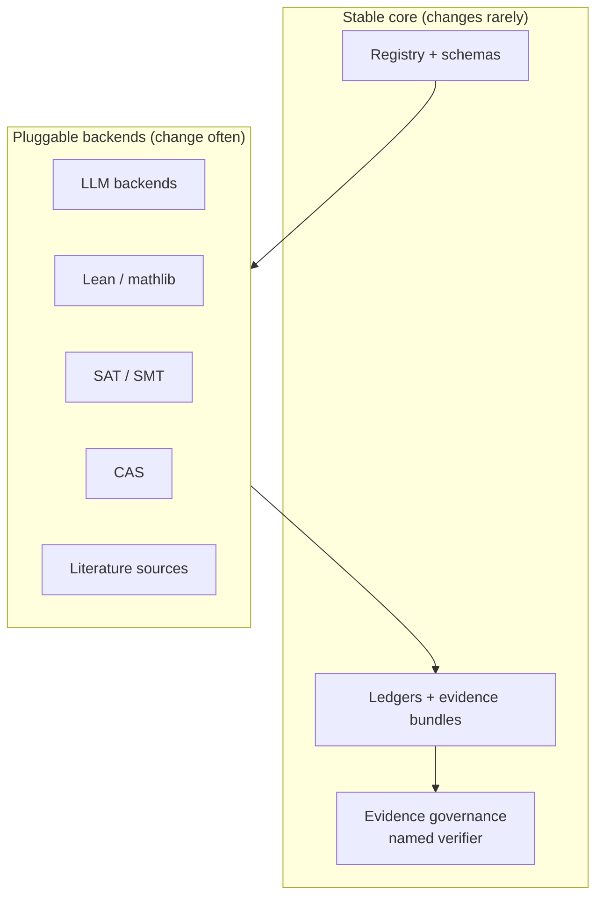

# OMEGA roadmap

A working plan, updated as things get done. Forecasts are marked as forecasts and come with their source. Nothing here is a promise.

Last update: 13 October 2026.

## Where things stand

Done in October 2026 (details in the [audit](AUDIT_2026-10.md)):

- [x] CI green on every workflow; all actions pinned by commit hash; least-privilege permissions for the bot workflow.
- [x] Thomson certificate: Hessian computed in full precision, saddle points no longer mistaken for minima, with tests.
- [x] Windows support: UTF-8 output, tests pass under a Russian locale.
- [x] First Lean statement, checked in CI with mathlib.
- [x] Dependency updates merged, Einstein Arena sync merged after checking every number.
- [x] README and documentation rewritten; fact-check table for every number.

## Next release (0.7)

- [ ] `external_ids` in the registry schema and an honest calibration of the triage tiers ([method](AMENABILITY_CALIBRATION.md)).
- [ ] Interval-arithmetic certificate for small Thomson configurations, so "local minimum" becomes a proof rather than a numerical statement.
- [ ] Lean statements for the other residue classes covered by Mordell's identities (n ≡ 2 mod 3, the classes mod 5, 7 and 8).
- [ ] One end-to-end example that goes registry → experiment → evidence bundle → verifier sign-off, runnable in a few minutes.
- [ ] Trim `docs/research/`: archive pitch and marketing notes out of the technical docs.
- [ ] Zenodo DOI for releases, so the software is citable with a persistent identifier (FAIR4RS, see below).

## Horizons

### Now to 2 years

What the field looks like: AI systems already produce formally verified solutions to some open problems. The first Erdős problem regarded as solved autonomously by AI came with a Lean proof in January 2026 ([arXiv:2601.07421](https://arxiv.org/html/2601.07421v5)). A large evaluation of formal proof search solved 9 of 353 open Erdős problems and 44 of 492 OEIS conjectures ([arXiv:2605.22763](https://arxiv.org/abs/2605.22763)). On a fixed benchmark of 68 hard open Erdős problems the best model solved 2 ([arXiv:2609.25050](https://arxiv.org/abs/2609.25050)). A frequent failure mode is not wrong proofs but "new" results that were already in the literature ([arXiv:2601.22401](https://arxiv.org/abs/2601.22401)).

What OMEGA does about it:

- Lean first. A result moves up an evidence class only with a Lean proof or a named human verifier.
- Novelty check before any claim, with the literature snapshot stored next to the result.
- Problem statements fixed in Lean early, because informal statements on public lists are often ambiguous (the #728 write-up describes exactly this).

### 3 to 5 years

Forecast: Epoch AI wrote in 2025 that benchmarks like FrontierMath "could be solved as early as 2027 on current trends", and that autonomous proofs of substantive results are "plausible" before 2030 ([AI 2030 report](https://epoch.ai/files/AI_2030.pdf)). Epoch itself flags that benchmark validity for real research is uncertain.

Trend: mathlib's live statistics show 137,943 definitions and 289,925 theorems from 772 contributors ([mathlib stats](https://leanprover-community.github.io/mathlib_stats.html), fetched 13.10.2026). A May 2026 talk quoted about 131,000 and 275,000 ([slides](https://zixiaowang17.github.io/assets/talks/towards-statlib-ini-2026-05.pdf)). The library keeps growing; OMEGA should rely on it rather than build its own.

What OMEGA does about it:

- Backends stay pluggable. Models and provers change every few months; the registry, ledgers and evidence format should not.
- Open, plain formats only: YAML, JSON Schema, JSON artifacts, Lean source. No lock-in to one vendor's API or file format.
- Track outcomes per tier against public records, so the triage gets better with data instead of opinion.

### 5 to 10 years

Nobody has reliable numbers this far out, and this roadmap will not invent them. What can be planned for is the direction: more of mathematics formalized, more proof search done by machines, and the bottleneck shifting to choosing good problems, stating them correctly and checking that results are new and meaningful.

What OMEGA does about it:

- Provenance that outlives the tools: every result records which model, prover, version, seed and literature snapshot produced it.
- Reproducible pipelines that can be rerun years later from pinned inputs.
- Follow the [FAIR principles for research software](https://www.nature.com/articles/s41597-022-01710-x): findable (DOI, metadata), accessible (open license), interoperable (open formats), reusable (tests, documentation, clear provenance).

## Architecture choices that should age well

| Choice | Why |
|---|---|
| Lean as the final judge | Formal proofs are the one check that does not depend on trusting the model that wrote them. |
| Plain text formats | Readable in ten years without the original software. |
| Pinned dependencies and actions | Reruns give the same result; supply-chain attacks get harder. |
| Named verifier rule | Stops a pipeline from grading its own homework. |
